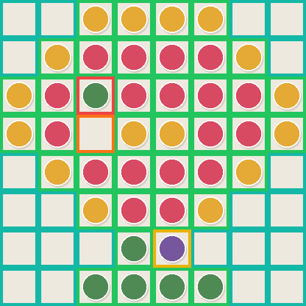

# PatternProof

**Find misplaced, missing, and unrecognized cells in a physical grid craft — without
uploading the photo.**

PatternProof compares a declared color grid with a rectified, tightly cropped photo or
scan. It checks every cell in CIELAB color space and produces JSON, CSV, an annotated
PNG, and a self-contained HTML report. Everything runs locally.



The example above contains one wrong known color at `R3C3`, one empty cell at `R4C3`,
and one uncertain color at `R7C5`. Green and teal outlines are accepted cells; orange,
red, and yellow outlines are findings.

## Why it exists

Pattern generators answer “what should I make?” PatternProof answers “does this
physical grid match the approved pattern?” Its output keeps the observed color and
distance behind every classification, so ambiguous lighting becomes `uncertain`
instead of a hidden guess.

The v0.1 scope is deliberately narrow: fuse beads, diamond painting, mosaics, and other
square-grid crafts whose pattern and grid bounds are already known. See the
[research and differentiation](docs/RESEARCH.md) for the project-selection evidence.

## Quick start

PatternProof requires Python 3.11 or newer. From a source checkout:

```console
uv sync --locked
uv run patternproof analyze examples/pattern.json examples/clean.png --out build/clean
uv run patternproof analyze examples/pattern.json examples/defects.png --out build/defects
```

The clean command exits `0`. The defect command writes the full report and exits `1`,
which is useful in a scripted quality check.

To install a release wheel instead, download it from the GitHub Release and run:

```console
python -m pip install patternproof-0.1.0-py3-none-any.whl
patternproof --version
```

## Capture contract

The input image must already be:

- cropped to the outside boundary of the declared rectangular grid;
- rectified so rows and columns divide evenly across the image;
- free from strong glare, deep shadow, and perspective distortion;
- large enough to provide at least 4 by 4 decoded pixels per cell.

Automatic crop, perspective correction, brand palette lookup, and cloud storage are
not part of v0.1. A report describes one controlled capture; it is not a guarantee
about the physical object.

## Pattern file

Version-one patterns are strict JSON. Palette keys are user-defined; `null` means an
intentional background cell.

```json
{
  "version": 1,
  "name": "Two-cell check",
  "empty_color": "#eee9df",
  "palette": {
    "R": {"name": "Petal", "color": "#d84a62"},
    "G": {"name": "Leaf", "color": "#4f8a55"}
  },
  "cells": [["R", "G"]]
}
```

Colors are six-digit sRGB hexadecimal values. Palette keys use 1–32 ASCII letters,
digits, dots, dashes, or underscores and must start with a letter or digit. A grid may
contain at most 512 rows, 512 columns, and 65,536 cells; a palette may contain at most
256 distinct colors, and the JSON file may contain at most 8,000,000 bytes. The
committed [example pattern](examples/pattern.json) is a complete working input.

## Status and exit behavior

| Status | Meaning |
| --- | --- |
| `match` | The expected palette color is nearest and within the threshold. |
| `background` | A declared `null` cell is nearest to `empty_color`. |
| `empty` | A colored cell appears nearest to `empty_color`. |
| `wrong` | A different declared palette color is nearest. |
| `uncertain` | No declared candidate is within the threshold. |

The default maximum CIE76 distance is `12`; change it explicitly with `--delta-e`.
The default central sampling inset is `0.2`; change it with `--inset`.

- Exit `0`: every cell is `match` or `background`.
- Exit `1`: at least one `empty`, `wrong`, or `uncertain` finding; reports are written.
- Exit `2`: invalid command, input, image, option, or output path; no partial report
  directory remains.

PatternProof refuses to overwrite an existing output path.

## Report artifacts

Every successful analysis writes one atomic directory:

- `report.json` — versioned machine-readable evidence and policy;
- `cells.csv` — flat per-cell evidence for spreadsheets;
- `overlay.png` — status outlines on the original capture;
- `report.html` — standalone human-readable report with the overlay embedded.

Coordinates are one-based (`R1C1`). JSON and CSV retain the expected key, nearest
candidate, median observed RGB/hex, expected distance, and nearest distance.

## Development and verification

```console
uv sync --locked --all-groups
uv run python scripts/check.py
```

The release-equivalent gate checks formatting, lint, strict typing, branch coverage,
dependency advisories, build contents, and clean-wheel CLI behavior. Generated examples
are reproducible with `uv run python scripts/generate_examples.py`.

Read [architecture](docs/ARCHITECTURE.md), [acceptance](docs/ACCEPTANCE.md), and
[troubleshooting](docs/TROUBLESHOOTING.md) before changing behavior. Contributions are
welcome under [CONTRIBUTING.md](CONTRIBUTING.md); security reports follow
[SECURITY.md](SECURITY.md).

## License

MIT © 2026 KanadeK
